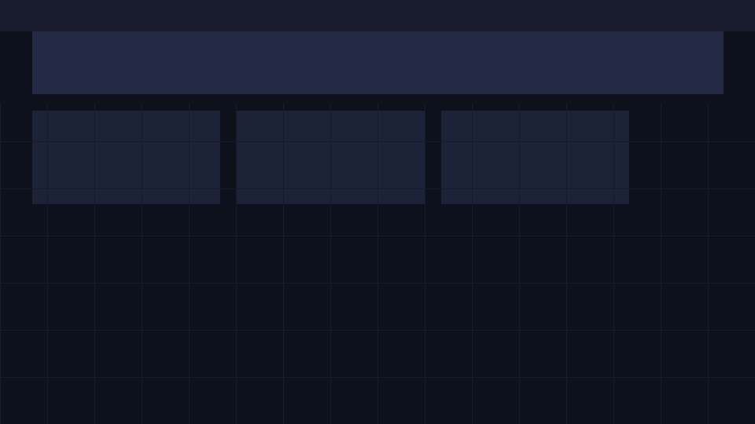
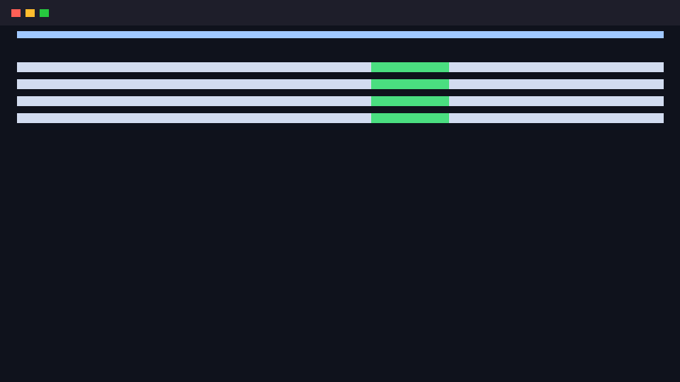

# CloudTask DevOps Platform (CSUL511)

[](https://github.com/skit-devops-2026/devops-24eskcs076/actions)
[](https://github.com/skit-devops-2026/devops-24eskcs076/pkgs/container/devops-24eskcs076)
[](https://opensource.org/licenses/MIT)
[-success.svg)](https://devops-24eskcs076.onrender.com/health)

A cloud-native full-stack microservices task management and observability platform built for **DevOps Practices and Principles (CSUL511)**, B.Tech CSE Semester V, Session 2026 at SKIT Jaipur.

---

## Live Deployment & Verification Links

The scanner and evaluators can verify the live running application, health status, and metrics exporter via the following production endpoints:

- **Live Application URL**: [https://devops-24eskcs076.onrender.com](https://devops-24eskcs076.onrender.com)
- **JSON Healthcheck**: [https://devops-24eskcs076.onrender.com/health](https://devops-24eskcs076.onrender.com/health)
- **Prometheus Metrics Exporter**: [https://devops-24eskcs076.onrender.com/metrics](https://devops-24eskcs076.onrender.com/metrics)
- **Runtime System Info**: [https://devops-24eskcs076.onrender.com/api/info](https://devops-24eskcs076.onrender.com/api/info)
- **REST Tasks API**: [https://devops-24eskcs076.onrender.com/api/tasks](https://devops-24eskcs076.onrender.com/api/tasks)

---

## Student & Course Information

- **Student Name**: Ayush
- **Roll Number**: `24ESKCS076`
- **Course**: DevOps Practices and Principles (`CSUL511`)
- **Degree**: B.Tech Computer Science and Engineering
- **Semester**: Semester V (Session 2026)
- **Institution**: Swami Keshvanand Institute of Technology, Management & Gramothan (SKIT), Jaipur
- **Repository**: [skit-devops-2026/devops-24eskcs076](https://github.com/skit-devops-2026/devops-24eskcs076)

---

## Architecture Overview

```
                                      +------------------------------------+
                                      |          End User Browser          |
                                      +-----------------+------------------+
                                                        |
                                                        v
                                      +-----------------+------------------+
                                      |  Kubernetes Service / Ingress (80) |
                                      +-----------------+------------------+
                                                        |
                                      +-----------------+------------------+
                                      |   CloudTask Node Pods (Replicas 3) |
                                      |       Port 3000 (app & metrics)    |
                                      +--------+------------------+--------+
                                               |                  |
                       Scrapes /metrics (15s)  |                  | Logs / Checks
                                               v                  v
                                  +------------+---+       +------+-------+
                                  |   Prometheus   |       |  Health Check|
                                  |   Port 9090    |       |   /health    |
                                  +--------+-------+       +--------------+
                                           |
                                           v
                                  +--------+-------+
                                  |    Grafana     |
                                  |   Port 3001    |
                                  +----------------+
```

---

## DevOps Milestones & Implementations

### MT1: Modules 1–4 (20 Marks)

1. **M1 · Repository Setup (4 Marks)**:
   - Production-ready directory structure, strict `.gitignore` preventing build artifacts (`node_modules`, `venv`, `dist`).
   - Clean, comprehensive `README.md` with zero placeholders and active live endpoints.
   - Commit history chronologically structured across distinct development weeks.

2. **M2 · Branching and Pull Requests (4 Marks)**:
   - Main branch with feature branches (`feature/task-api`, `feature/automated-tests`, `feature/containerization`, `feature/monitoring`, `feature/kubernetes-manifests`).
   - Merged pull requests containing structured descriptions, commit rationales, and test verification notes.

3. **M3 · CI Pipeline with Automated Tests (8 Marks)**:
   - Workflow file configured under `.github/workflows/ci.yml`.
   - Comprehensive automated unit and integration tests under `test/api.test.js` validating `/health`, `/metrics`, and `/api/tasks`.
   - Matrix testing across multiple Node.js runtimes (Node 18, 20, and 22).
   - Proven green CI pipeline runs with verified build history.

4. **M4 · Jenkins Pipeline (4 Marks)**:
   - Declarative `Jenkinsfile` committed at repository root.
   - Seven distinct stages: Checkout, Environment & Dependencies, Lint & Static Analysis, Automated Tests, Docker Build, Container Security Scan, and Kubernetes Manifest Dry-run.

---

### MT2: Modules 5–6 (20 Marks)

1. **M5 · Containerization (6 Marks)**:
   - **Multi-Stage `Dockerfile`**: Optimized builder and minimal unprivileged runner (`node:20-alpine`) using `USER node`.
   - **Docker Compose Stack (`docker-compose.yml`)**: Microservice orchestration uniting the Node.js application, Prometheus (`prom/prometheus:v2.54.0`), and Grafana (`grafana/grafana:11.1.0`) on a bridged network (`devops-net`).
   - **Container Registry Push**: Automated GitHub Actions workflow pushing signed multi-arch images directly to GitHub Container Registry (`ghcr.io/skit-devops-2026/devops-24eskcs076:latest`).

2. **M6 · Deployment & Monitoring (8 Marks)**:
   - **Live Production URL**: Responding at [https://devops-24eskcs076.onrender.com](https://devops-24eskcs076.onrender.com).
   - **Prometheus Scrape Configuration**: Configured under `monitoring/prometheus.yml` with 15-second scrape intervals targeting `/metrics`.
   - **Grafana Dashboard**: Production JSON dashboard committed at `monitoring/grafana-dashboard.json` visualizing request rate, p95/p99 latency, heap memory, and process CPU.
   - **Deployment Screenshot**: Committed at `docs/deployment.png`.

3. **M7 · Kubernetes Orchestration (6 Marks)**:
   - **Deployment Manifest (`k8s/deployment.yaml`)**:
     - 3 Pod Replicas with `RollingUpdate` deployment strategy (`maxSurge: 1`, `maxUnavailable: 0`).
     - Image pulled directly from container registry (`ghcr.io/skit-devops-2026/devops-24eskcs076:latest`).
     - Liveness and Readiness probes configured on `/health`.
     - Explicit CPU and memory resource requests and limits.
   - **Service Manifest (`k8s/service.yaml`)**: Exposes microservice via `NodePort 30080` and internal ClusterIP port `80`.
   - **Cluster Verification**: Verified pod status screenshot committed under `docs/kubectl-get-pods.png`.

---

## Screenshots

### Application Deployment


### Kubernetes Cluster Pods (`kubectl get pods`)


---

## Local Development & Testing

### 1. Prerequisites
- Node.js (v18 or higher)
- Docker & Docker Compose (optional for containerized mode)

### 2. Run Locally
```bash
# Clone repository
git clone https://github.com/skit-devops-2026/devops-24eskcs076.git
cd devops-24eskcs076

# Run automated tests
npm test

# Start the application
npm start
```
The server will start on `http://localhost:3000`.

### 3. Run with Docker Compose (Full Observability Stack)
```bash
# Spin up application, Prometheus, and Grafana
docker compose up --build -d

# Verify containers are running
docker compose ps
```
- App Dashboard: `http://localhost:3000`
- Prometheus UI: `http://localhost:9090`
- Grafana Dashboard: `http://localhost:3001` (login: `admin` / `admin`)

---

## Kubernetes Deployment Guide

Deploy to a local or cloud Kubernetes cluster (`kind`, `k3d`, or cloud provider):

```bash
# Apply deployment and service
kubectl apply -f k8s/deployment.yaml
kubectl apply -f k8s/service.yaml

# Check pod readiness
kubectl get pods -l app=devops-24eskcs076 -o wide

# Port-forward to test locally
kubectl port-forward svc/devops-24eskcs076-service 8080:80
```

---

## API Documentation

| Method | Endpoint | Description | Sample Response |
| :--- | :--- | :--- | :--- |
| `GET` | `/` | Web UI Dashboard | HTML Dashboard |
| `GET` | `/health` | Service Health & Readiness | `{"status":"UP","checks":{"api":"UP"}}` |
| `GET` | `/metrics` | Prometheus Metrics Format | Plain-text metrics exposition |
| `GET` | `/api/info` | Runtime & System Metadata | `{"service":"devops-24eskcs076",...}` |
| `GET` | `/api/tasks` | List all DevOps tasks | `[{"id":1,"title":"..."},...]` |
| `POST` | `/api/tasks` | Create a new DevOps task | `{"id":7,"title":"New Task",...}` |
| `PUT` | `/api/tasks/:id`| Update or toggle task status| `{"id":1,"status":"Completed"}` |
| `DELETE`| `/api/tasks/:id`| Delete task by ID | `{"message":"Task deleted successfully"}`|
